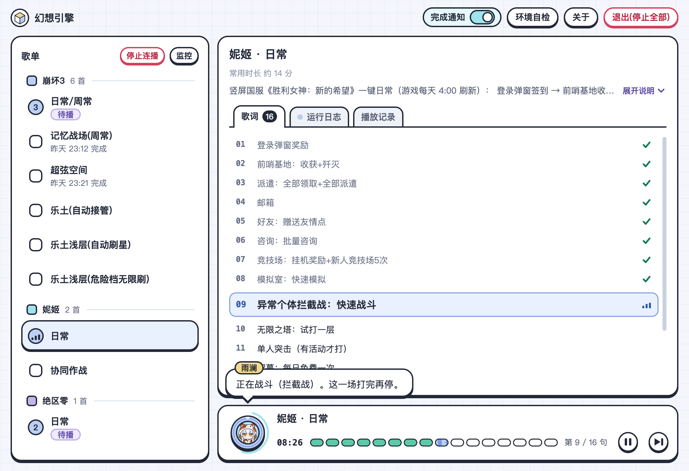
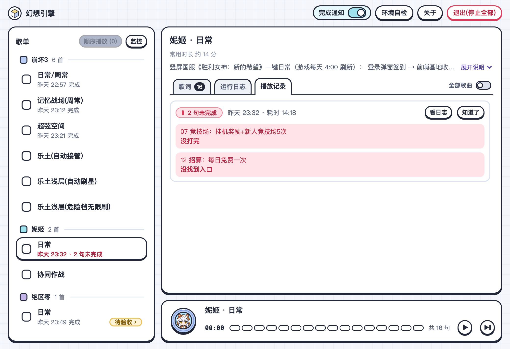

<picture>
  <source media="(prefers-color-scheme: dark)" srcset="docs/logo/phantasia-lockup-dark.svg">
  
</picture>

# 幻想引擎 Phantasia Engine

把手游每天要做的日常排成一张歌单。在 Mac 上点一下播放，电脑通过 ADB 在 Android 设备上替你把事做完；做了什么、哪一步没做完，都记在播放记录里。

<p>
  
</p>

<sub>正在播「妮姬 · 日常」：左边是歌单，中间是歌词（做过的打勾，正在做的高亮），右下是播放区。战斗中点了暂停，雨澜说这一场打完再停。画面是用演示数据拍的。</sub>

> 幻想引擎是一只看不见的魔方，把游戏里每天要做的事复现成一张歌单；现在执掌它的是雨澜——她替你把日常打完，你只看播放记录。

## 四张图看懂


<sub>四张图由 Codex（ChatGPT）的生图工具生成，画风和「老板」的人设跟 <a href="https://github.com/NPCONTEXT/Qlimen">Qlimen</a>、<a href="https://github.com/NPCONTEXT/Qlimen-Tabula">无限表格</a>、<a href="https://github.com/NPCONTEXT/GGIF">GGIF</a> 的图是同一套。拼成一张的长图在 <a href="docs/漫画/幻想引擎-一图流.jpg">docs/漫画/幻想引擎-一图流.jpg</a>。</sub>

---

## 30 秒看懂

1. **歌单**就是工具列表：一个游戏是一张专辑，一个脚本是一首歌，脚本要做的每一步是一句歌词。
2. **播放**：选中一首点 ▶。或者给几首编上序号点「顺序播放」，一首接一首全自动跑完，中间自己开游戏、关游戏。
3. **看结果**：每次运行记一条播放记录，没做完的步骤和原因直接写在上面；每首歌结束时截一张设备画面，等你验收。
4. **想自己接手**就点暂停。战斗中停不了，雨澜会冒个气泡告诉你什么时候能停。

<p>
  
</p>

<sub>播放记录：哪一句没做完、为什么，直接写在上面；右下「待验收」是那首歌结束时截的设备画面，等你看一眼。画面是用演示数据拍的。</sub>

## 先说清楚

这是作者每天自己在用的东西，照作者的设备、账号和习惯写的，不是装上就能通用的工具。更合适的用法是当成一份完整的实现，照着改成你自己的。

- **屏幕**：脚本里的坐标按 2400×1504（16:10，竖屏的游戏是 1504×2400）写。设备比例不一样时，界面可以临时把设备分辨率切过去（退出时还原），但别的设备上按钮位置不一定对得上。
- **游戏**：只认国服、简体中文界面，脚本靠认屏幕上的字和小图标找位置。游戏一更新，页面和位置就可能变，要自己改脚本。
- **账号**：有的步骤要求对应玩法已经解锁；乐土只有符华、愈生佑翎两个角色的档案；记忆战场只打学过的 BOSS（`profiles/` 里有档案的）。
- **花不花东西**：花付费货币的按钮一律不点。体力、金币这类日常资源会按每首歌说明里写的规则用掉，播放前先看说明。
- **风险**：用脚本代替手动操作可能违反游戏的用户协议，账号因此受到的处理由你自己承担。本项目和这些游戏的开发商、运营商没有关系。
- **电脑**：只支持 Apple 芯片的 Mac（识字用的是 macOS 自带的 Vision）。

## 歌单里现在有什么

| 专辑 | 歌 | 做什么 |
|---|---|---|
| 崩坏3 | 日常/周常 | 签到、一键减负、舰团委托、材料、家园、每周分享、任务和礼盒、冒险委托、商店、活动、战令、邮件 |
| 崩坏3 | 记忆战场(周常) | 三个 BOSS 减负；学过的 BOSS 按档案编队正式打，没学过的只报不打 |
| 崩坏3 | 超弦空间 | 读本期状态；没打满的区用推荐阵容打，高危区凹分；领深渊任务 |
| 崩坏3 | 乐土(自动接管) | 从主界面进乐土，战斗、选刻印、找门换层、商店采购，打到结算、领九档周常 |
| 崩坏3 | 乐土浅层(自动刷星) | 停在备战页开始，安全、普通、危险三档各打到三星 |
| 崩坏3 | 乐土浅层(危险档无限刷) | 三档达成后反复打危险档，直到你点停 |
| 妮姬 | 日常 | 前哨基地、派遣、邮箱、好友、咨询、竞技场、模拟室、拦截战、无限之塔、单人突击、免费招募、商店、任务、通行证 |
| 妮姬 | 协同作战 | 限时活动开着时，用掉当天的奖励次数（只打普通难度） |
| 绝区零 | 日常 | 喝茶、零食盲盒、录像店、实战模拟室最多 3 场、活跃度奖励、丽都周纪、丽都城募 |

每首歌的完整流程、开始前游戏要停在哪个画面，在界面里点「展开说明」能看到。

## 要准备什么

- Apple 芯片的 Mac。作者用的是 macOS 26；更早的系统没试过。
- 一台 Android 设备，打开 USB 调试（或无线调试：第一次要配对，见 `docs/使用教程.md`），装好上面这些游戏的国服。
- [Homebrew](https://brew.sh)，然后：

```bash
brew install android-platform-tools ffmpeg python@3.13
```

- Xcode 命令行工具（编识字程序要用，macOS 自带的 `/usr/bin/python3` 也是它带的）：

```bash
xcode-select --install
```

## 安装

```bash
git clone https://github.com/NPCONTEXT/Phantasia-Engine.git
```

```bash
cd Phantasia-Engine
```

```bash
./install.sh
```

`install.sh` 做四件事：建界面的运行环境 `venv-qt.nosync/`（PySide6）、建脚本的运行环境 `bh3_auto/.venv/`（OpenCV、NumPy、ONNX Runtime）、编两个识字小程序、把脚本里的设备序列号写成你现在连着的那台。它只在项目目录里写东西，不要管理员密码，要联网下载依赖。

装的时候没连设备也行：经幻想引擎播放时，脚本用的是它挑中的那台（插着线走线，没插线走无线调试）。只有不经幻想引擎、在终端里单独跑脚本时，才要连上设备后补一次：

```bash
python3 scripts/set_device.py
```

## 打开

双击 `幻想引擎.app`（它得留在项目目录里），或者在终端里：

```bash
./启动幻想引擎.command
```

第一次打开先看右上角的「环境自检」：按钮是红边，就是有哪一项没过，点开能看到原因。怎么播放、怎么排队、怎么看结果，写在 [docs/使用教程.md](docs/使用教程.md)，界面右上角的「关于」里也能看。

## 手机提醒（可选）

该做的日常没做完时，往微信推一条「【雨澜】…」的提醒。是一个单独的定时任务，装法见 [tasks/2026-10-19-主动提醒/README.md](tasks/2026-10-19-主动提醒/README.md)。

## 目录

| 位置 | 是什么 |
|---|---|
| `main.py`、`core/`、`ui/` | 界面和播放：歌单、顺序播放、播放记录、暂停、结束截图 |
| `tools.json` | 歌单。每首歌的名字、说明、歌词、工作目录、启动命令都在这里 |
| `lib/play_ctl.py` | 暂停协议，脚本这一头用的几个函数 |
| `bh3_auto/` | 乐土的引擎、公用的 ADB、触控、看图模块，脚本的运行环境也在这里 |
| `tasks/` | 各首歌的脚本和它们用的模板小图、打法档案 |
| `test_fake/` | 界面的离线测试：用假脚本代替真游戏，不连设备 |
| `docs/` | 使用教程、更新日志 |
| `.claude/skills/make-game-script/` | 给 AI 助手看的技能：怎么从零做一首新歌（见下一节） |

## 加一首自己的歌

1. 在 `tasks/` 下建一个目录放脚本。截图、点按、识字可以照现成的写法：短的看 `tasks/2026-11-01-妮姬协同作战/nikke_coop.py`，完整的看 `tasks/2026-10-06-妮姬日常/nikke_daily.py`。
2. 在 `tools.json` 的 `tools` 里加一条，照现成的填：`workdir` 是工作目录，`command` 是启动命令，`tasks` 是歌词（一步一句），`precheck` 是开播前要在的文件，`package` 是游戏的包名（顺序播放时用它开关游戏）。
3. 想让这首歌能暂停，照 `lib/play_ctl.py` 开头的说明，在截图的地方加 `pause_point()`，战斗的那一段包上 `battle(...)`。
4. 重新打开幻想引擎，新歌就在歌单里。

完整的做法写成了一份技能 [`.claude/skills/make-game-script/`](.claude/skills/make-game-script/SKILL.md)：要准备什么、日常和战斗两类脚本各怎么做、怎么接上歌词进度和暂停、常见的坑。在项目根目录启动 Claude Code 时会自动发现它，聊到做新脚本时会用上，也可以输入 `/make-game-script` 直接调出；用别的 AI 助手，把这个目录里的 `SKILL.md` 和 `references/` 交给它读就行，自己照着做也可以。

## 测试

界面的测试不连设备，在项目根目录跑：

```bash
( for t in subitems roles startup pause play_ui review_jump persona device_pick; do QT_QPA_PLATFORM=offscreen venv-qt.nosync/bin/python test_fake/test_$t.py || exit 1; done )
```

各游戏脚本自己的测试要用带账号信息的整屏截图当素材，没有放进仓库。

## 许可

代码按 [MIT](LICENSE) 许可发布。仓库里带的别人的东西（触控程序 MaaTouch、乐土的检测模型）、游戏画面里裁出来的模板图，以及雨澜的形象和魔方标志的说明，见 [THIRD_PARTY_NOTICES.md](THIRD_PARTY_NOTICES.md)。

## 名字和雨澜

幻想引擎和凌雨澜都出自作者自己写的小说。书里，幻想引擎是一只不可视的魔方，管着「网游」和「虚实转换」；雨澜是整天端着游戏机、能看穿判定帧的人，话很少，说的都是短句。所以在这个工具里，名字和标志是引擎，出来说话的是她。
